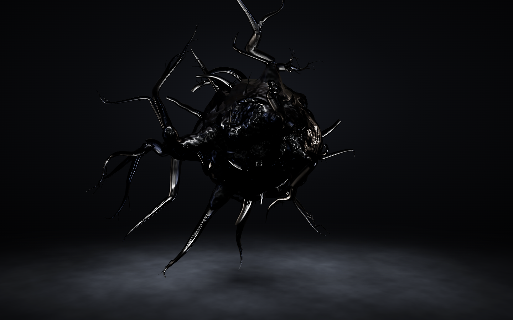
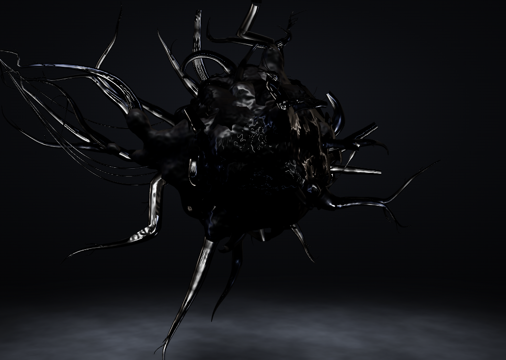
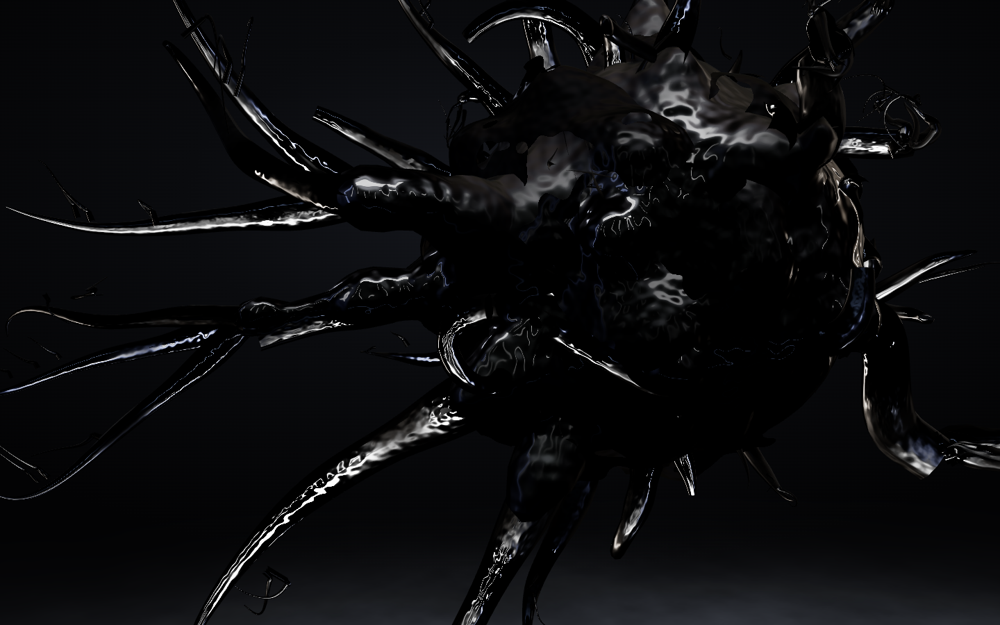
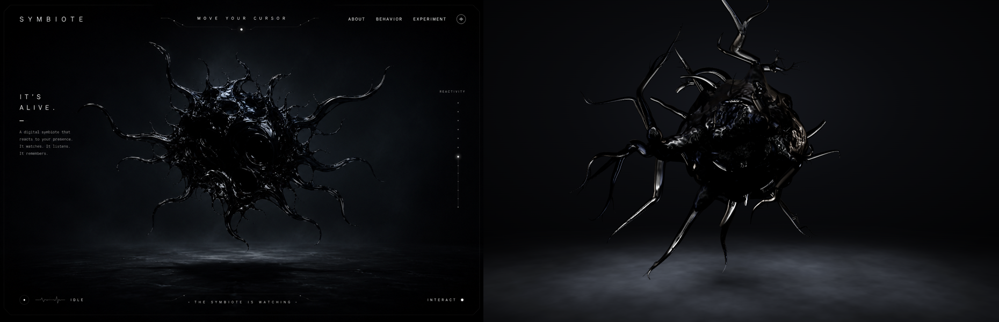

# Symbiote

**An interactive WebGL organism.** A floating, wet-black, symbiote-like
creature lives in the middle of a dark page and reacts to your cursor. It
watches the cursor, reaches for it, coils around it and lets go. The cursor
disturbs its life rather than steering it like a joystick.



Built with [three.js](https://threejs.org/) and [Vite](https://vitejs.dev/).
There's no backend and no build-time assets: everything is generated in code at runtime.

---

## Contents

- [Quick start](#quick-start)
- [Interacting with it](#interacting-with-it)
- [How it looks the way it does](#how-it-looks-the-way-it-does)
- [How it behaves](#how-it-behaves)
- [Architecture](#architecture)
- [Performance](#performance)
- [Project layout](#project-layout)
- [Target vs. current](#target-vs-current)
- [Roadmap](#roadmap)

## Quick start

Requires Node.js 18+ and a browser with WebGL 2.

```bash
npm install
npm run dev        # http://localhost:5199
```

| Script | What it does |
| --- | --- |
| `npm run dev` | Dev server with hot reload on **http://localhost:5199** |
| `npm run build` | Production build into `dist/` |
| `npm run preview` | Serves the production build on http://localhost:5199 |

The port is fixed at 5199 with `strictPort` (see `vite.config.js`). If another
project is already using it, Vite stops with an error instead of quietly
moving to another port, so you never end up looking at the wrong app.

## Interacting with it

| You do | The creature does |
| --- | --- |
| Leave the cursor alone | Breathes, drifts and slowly turns. Its arms sway on their own |
| Move the cursor near it | A few curious arms lean toward it and watch |
| Hold the cursor within reach | Two or three arms (never all of them) reach for it, with the bend travelling out from the base, and coil their tips around it. The body throws goo strings at it |
| Keep holding | The arms tire. One lets go, leaving a goo string stuck to the cursor, and rests while another takes its turn |
| Drag the held cursor around | The arms follow with lag and whip, like springs. The strings stretch, thin, bead and snap |
| Flick the mouse fast | Nervous arms flinch back or let go; bold ones hold on |
| Move the cursor away or off the page | The arms let go from the tip back and recoil |



## How it looks the way it does

| Look | Technique |
| --- | --- |
| **One fused, organic mass** | The body, trunk roots, forks and merges are one implicit surface: a density field polygonized with marching cubes. Strands that come close fuse with smooth fillets instead of crossing with hard creases |
| **Many into one, then one into many, over time** | 14 *bundles* (every fork's arms, and groups of neighbouring trunks) each run their own zip cycle. A zip front pulls the strands onto a shared centre line, so they fuse into one wider rope. The rope holds for a while, then unzips from the tip and splits back into several strands. Some bundles zip from the root, others from the middle (braids) |
| **Sticky** | Wherever goo comes apart (a bundle unzipping, tips that touched, an arm letting go of the cursor), a goo string stays stretched across. It keeps its volume, so it thins as it stretches, beads up, sags and snaps, and each half whips back and is absorbed |
| **Mixed lengths, mostly short** | Power-law length classes: 7 long reachers, 12 medium arms and 15 short buds |
| **Fully 3D** | Arms leave the body in every direction, including toward and away from the viewer |
| **Fine, hair-like tips** | Instanced GPU tubes, bent along simulated spines in the vertex shader. They taper out of the fused mass |
| **Semi-dry goo, not chrome** | `MeshPhysicalMaterial`, lit only by a strip-light PMREM environment and patched per pixel (`goo.js`). A slow smear field mixes wet patches (sharp clearcoat) with satin ones. The analytic gradient of a noise height field bends the normal, so highlights break into ripples and flecks. On tendrils the relief runs along the strand like muscle fibre |
| **Dark cavities** | For every vertex, the worker samples the density field just outside the surface. In folds and between fused strands there's still goo there, so reflections are suppressed: ambient occlusion straight from the field |
| **Holed webbing** | Noise-perforated membranes between neighbouring arms and in fork crotches |
| **Cinematic stage** | A misty floor lit from above, under a dark radial background |



Each of these properties, with its source and how it's built, is listed in
[docs/VENOM_GOO_PROPERTIES.md](docs/VENOM_GOO_PROPERTIES.md).

The random layout is seeded (mulberry32), so the creature has the same
art-directed shape on every load.

## How it behaves

- **Its own equations:** every tendril has a *motion genome*, a set of motion terms with its own coefficients:
  - a curvature wave built from three harmonics with its own ratios, weights and phases, on two axes so the tip traces 3D figures
  - a slow Lissajous sway about its root
  - curl breathing
  - bulges travelling outward along it
  - random flicks at its own rate

  Its temperament (bold, nervous, curious) and its viscosity scale all of these.
- **Spring follow:** every spine point is a second-order spring chasing its target. Tips are looser than roots, which gives the arms lag, overshoot and whip. Engaged arms stiffen and quiet their idle motion, so they move with purpose.
- **Not all at once (response thresholds):** each reacher reconsiders at its own reaction time. It commits when the stimulus it feels (facing the cursor and able to reach it) beats its own threshold. Every arm already engaged weakens that stimulus for the rest, so at most three go. Holding tires an arm out: it lets go and rests, and another takes over.
- **Reach as a travelling bend:** as with an octopus arm, a reach is a front moving from base to tip, and only the part behind it has committed. Letting go runs the front back from the tip.
- **Grab:** the last stretch wraps into an irregular, tilted coil, so no two coils are perfect circles.

## Architecture

```
pointer ──► cursor (raycast onto the creature's plane, smoothed speed)
               │
               ▼
          rig.update()            CPU: tendril simulation (genomes, bundles, springs,
               │                       cursor allocation) + goo strings
               │ spine points + normals
      ┌────────┴──────────┐
      ▼                   ▼
 tubes / webbing      mass.update()  ──postMessage──► massWorker
 (GPU: spines in       (packs thick                  (stamps the density field,
  float textures,       segments)                     runs marching cubes)
  vertex shader)                  ◄──transferable buffers── triangles
      │                   │
      └────────┬──────────┘
               ▼
        three.js render (PMREM strip-light environment, ACES tone mapping)
```

## Performance

- Building the fused surface (stamping the field plus marching cubes) takes about 20 ms, so it runs in a **Web Worker**. Only one job is in flight at a time, the buffers are transferred rather than copied, and the main thread uploads only the triangles that were produced.
- All tubes are drawn as **one instanced mesh**, and the shape of every tendril is read from float textures.
- The goo strings are extra instances of the same tube mesh, so they cost no extra draw call.
- The wet/dry smear is computed per vertex. Only the relief runs per pixel, and it's skipped on hair-thin strands.
- The goo surface costs about a quarter of the frame rate of the plain material. On a busy laptop with an AMD iGPU, the previous build ran at 61 fps and this one at 40–45. On an idle machine, the previous build measured 100–120 fps.

## Project layout

```
index.html                 canvas + module entry
vite.config.js             fixed dev/preview port (5199)
src/
  main.js                  renderer, camera, materials, cursor, frame loop
  style.css                page background
  creature/
    rig.js                 tendril topology + simulation (genomes, bundles, cursor allocation)
    strings.js             sticky goo strings (thinning, beads, snap, recoil)
    goo.js                 goo surface shader patch (smear, relief, cavity occlusion)
    tubes.js               instanced tube geometry bent along spines
    mass.js                drives the fused implicit surface
    massWorker.js          field stamping + marching cubes (Web Worker)
    massConfig.js          field settings shared with the worker
    webbing.js             holed membranes between arms
    shell.js               perforated film around the body
    env.js                 strip-light studio environment (PMREM)
    stage.js               misty floor
    noise.js               shared GLSL simplex noise
docs/
  SYMBIOTE_INTERACTIVE_WEBGL_SPEC.md   creative direction + technical spec
  VENOM_GOO_PROPERTIES.md              every goo property, its source, and how it's built
  images/                  README renders
mockup references/         visual target
scripts/
  screenshot.mjs           Playwright screenshot helper
  fps-check.mjs            Playwright frame-rate probe
```

## Target vs. current

On the left is the mockup this project is aiming for. On the right is a render
of the current build.



## Roadmap

- [x] Semi-dry goo surface: smeared gloss, rippled relief, dark cavities
- [x] Fine tapering tendrils and holed webbing
- [x] Cursor sniff, grab, coil, flinch and release
- [x] Mixed tendril lengths and a fully 3D layout
- [x] Organic topology: forks, merges and braids fused into one mass
- [x] Strands that zip into one rope and split again, over time
- [x] Sticky goo strings that thin, bead, sag and snap
- [x] Per-tendril motion equations; only a few arms go for the cursor, taking turns
- [ ] Splashier, less ball-like core
- [ ] Fine splatter droplets
- [ ] Page UI from the mockup (nav, "It's alive." copy, reactivity meter, status bar)
- [ ] Touch tuning and a reduced-motion mode

See [the spec](docs/SYMBIOTE_INTERACTIVE_WEBGL_SPEC.md) for the full creative
direction.
